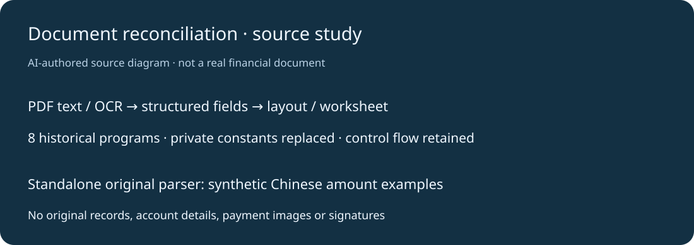

# 单据文本与排版脚本研究

保存8个历史PDF文本提取、中文大写数字解析、OCR版面整理和Excel核对表脚本。公开包只保留程序：全部真实账户、金额数据集、付款图片、发票、签名、个人输出路径与私密行内说明排除；嵌入数据改为明确合成占位。原函数和非字面量控制结构逐项一致。



## 最简运行

Python3.12及更新版本，无额外依赖；从原`parse2.py`提取的中文数字函数可独立运行：

```sh
python scripts/chinese_amount_demo.py 壹佰贰拾叁元肆角伍分
```

输出`123.45`。入口拒绝未支持字符，但原算法没有完整单位次序校验，使用浮点并保留原round行为；仅作文本解析练习，不适合作为结算、会计或税务规则引擎。

## 源码与前置条件

`archive/*.py.txt`分别保全8个版本，因缺少合法输入和实机配置而默认不可直接执行。技术依赖为Python、openpyxl、PyMuPDF及可选RapidOCR/ONNX Runtime；本次没有安装或运行OCR模型，没有读取真实财务文档，也没有改写原PDF。需要重用时应先独立适配输入与输出参数，使用自己的合法示例。

PyMuPDF采用AGPL/商业双轨条款，RapidOCR与模型、ONNX Runtime及openpyxl各按其原许可；本仓库不分发这些包或模型，根MIT只覆盖自有脚本与整理，不能替代依赖许可。

## 验证与计划

8份历史源完成Python语法检查和非字面量AST对照，函数与控制结构保留；5个明确合成金额CLI样例实际通过，未支持字符退出2。数据集、私密路径和行内说明经过移除，两次秘密扫描及已知长私密字面量精确比较用于公开检查，扫描结果不是绝对保证。

2026-10-27：建立源码研究档案和最小独立入口。后续可把每个历史工具重构为参数化、可验证的合成PDF/OCR流程；当前未验完整单据重建、电子表格版式、OCR或业务核对效果。真实原始资料没有托管，原会话目录继续保留。
